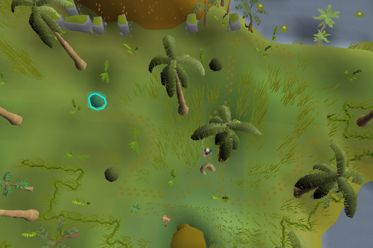

# Kebbit Tracker

A RuneLite plugin for Hunter tracking with a noose wand.

## Features

- **Hiding spot highlight**: after inspecting a den, the hiding spot at the end of the revealed track is outlined.
  - With a ring of pursuit, the whole trail is revealed and the spot the creature is hiding in is highlighted.
  - Without one, the next spot to search is highlighted as the trail is uncovered.
- **Ring of pursuit charges**: an infobox shows the remaining charges while the ring is worn.
- **Noose wand warning**: a reminder appears above the hiding spot if no noose wand is equipped.

## Supported creatures

| Creature | Location | Hiding spot |
| --- | --- | --- |
| Polar kebbit | Rellekka Hunter area | Snow drift |
| Common kebbit | Piscatoris Hunter area | Bush |
| Feldip weasel | Feldip Hunter area | Bush |
| Desert devil | Uzer Hunter area | Disturbed sand |
| Razor-backed kebbit | Piscatoris Hunter area | Bush |

Herbiboars are not included; use RuneLite's built-in Herbiboar plugin.

## Configuration

| Option | Description |
| --- | --- |
| Highlight color | Outline color for the hiding spot |
| Outline width | Thickness of the outline |
| Fill clickbox | Shade the hiding spot's clickbox |
| Ring of pursuit charges | Show the charges infobox |
| Noose wand warning | Warn when no noose wand is equipped |
| Highlight last track | Also mark the final tile of the trail |

## Notes

- Overlays stay hidden until a trail is revealed, and hide again after 5 minutes without a trail or when leaving the hunting area.
- Ring charges are read from game messages. If the infobox shows `?`, use **Check** on the ring once.
